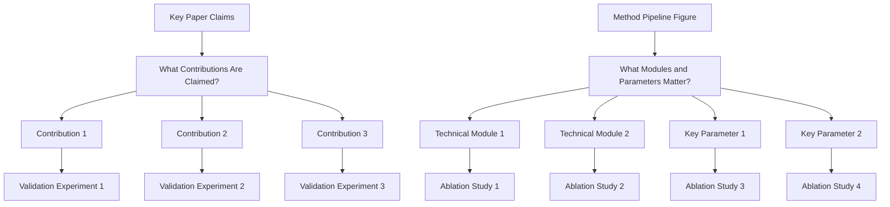

# Experiments Writing Guide

Fused from Peng Sida's notes (what the experiments must show, planning, tables) and the experiments sections of 55 award papers (shape, six moves, rules).

## Goal
Convince reviewers with complete evidence on effectiveness, causality, and practical value.

## Shape (what the corpus shows)
| Observation | Value |
|---|---|
| Length | median ~1,500 words (main paper; more in the appendix) |
| Opener | a roadmap sentence (“In this section, we …” appears in 18 / 55 papers) or the questions the experiments answer (DPO, pixelSplat; 12 / 55 frame experiments as questions somewhere) |
| Setup (datasets, metrics, baselines, implementation) | usually first; 13 / 42 have a subsection titled “Setup / Implementation details / Settings”, others use run-in paragraphs |
| Main results | one subsection per benchmark or task (Swin: ImageNet, COCO, ADE20K; Mip-Splatting: Blender, Mip-NeRF 360) |
| Ablations | 28 / 55 papers report ablations; usually the last numbered subsection before analysis |
| Qualitative results | 30 / 55 |
| Limitations | discussed in 43 / 55, as a subsection at the end of experiments (DreamBooth, Mip-Splatting) or as its own section |
| Supplementary material referenced | 44 / 55 (details that do not change the story go there) |

## Three Core Questions
1. Is the method better than strong baselines?
   - Run comparison experiments against strong and recent baselines.
   - Report standard metrics on the main benchmark(s).
   - Include SOTA or strongest public methods, not only weak baselines.
   - Keep protocol fair (same data split, preprocessing, and evaluation settings).
   - If the task is new and no directly related baseline exists, construct baselines from variants of our method (the notes' example: NeRF in the Wild, arXiv 2008.02268).
2. Which modules/design choices make the gain?
   - Run ablation studies for each key module/design choice.
   - Use remove/replace/disable variants. Print each variant's value next to the full model's; with both values printed, do not also print their difference.
   - Include component interaction ablations when modules are coupled.
3. How far can the method generalize under harder settings?
   - Once the method works on the target data, run demos/evaluations on newer, harder or out-of-distribution data to find its limit. Readers want to see how far a method goes; showing it is a contribution in itself.
   - Aim demos and applications at the downstream research community: work out what that community wants to see. This strongly affects the paper's impact.
   - Add stress-test scenarios (more complex scenes, rarer cases, noisier inputs, or stricter constraints).
   - When the paper discusses limitations, report failure modes next to the gains to show realistic boundaries.

## Experiment Planning
**Evidence map first.** Before writing, list every claim from the abstract, introduction and method, and the table/figure that proves it. A claim without evidence is softened in the introduction or gets an experiment `[TODO]`; an experiment that proves no claim moves to the appendix. The decisive experiment for each main-text claim stays in the main text; the appendix only adds settings and breakdowns. A claim that names several instances ("with two models", "on three simulators") needs a main-text cell for each instance, and a transfer claim ("trained in one domain, it wins on another") needs a main-text cell produced exactly that way (`../../shared-references/manuscript-craft.md` §2, Experiments).



## The Six Moves
**E0 · Opener.** One to three sentences: what is evaluated and in what order, or the questions the experiments answer.
> “We first present the implementation details of Mip-Splatting. We then assess its performance on the Blender dataset and the challenging Mip-NeRF 360 dataset. Finally, we discuss the limitations of our approach.” (Mip-Splatting)
> “… we ask: how efficiently does DPO trade off maximizing reward and minimizing KL-divergence with the reference policy …?” (DPO)

**E1 · Setup.** Datasets (size, split, why chosen), metrics (with direction ↑/↓), baselines (why these, how they were run: official code, same data), implementation (base code, iterations, hardware). Run-in headings are normal here (`\paragraph{Datasets.}`). The Setup defines what the main text uses and nothing else: a variant or data subset the final method does not use is defined beside its ablation, wherever that ablation sits.
> “We build our method upon the popular open-source 3DGS code base. Following [18], we train our models for 30K iterations across all scenes and use the same loss function …” (Mip-Splatting)
> “We compare our results with Textual Inversion, the recent concurrent work of Gal et al., using the hyperparameters provided in their work.” (DreamBooth)

**E2 · Main results: claim first, then evidence, then reason.** Start the paragraph with the finding, cite the table, quantify the most important margin, then explain why with reference to the method, then point to the qualitative figure.
> “We report quantitative results in Table 1. Our method outperforms the baselines on all metrics, with especially significant improvements in perceptual distance (LPIPS). … Compared to the baselines, our method is better at capturing fine details and correctly inferring 3D structure …” (pixelSplat)

With many benchmarks, the finding is stated per kind of setting, not per benchmark: group the benchmarks by what they test and give each group one verdict, the one that holds for every member. The table holds the values; a benchmark is named alone only where it departs from its group or carries the reason.

```text
Avoid (a test log):  Ours significantly outperforms B on A1, A2 and A3, and outperforms it on A4.
                     It significantly outperforms C on A1 and A5, and outperforms it on A2 (Table 1).
Write (a finding):   Ours outperforms both baselines on every long-horizon benchmark (Table 1),
                     by <the one margin that carries the claim>. <Reason from a measurement in
                     the paper or a property the data have by construction.>
```

**E3 · Ablations mirror the claims.** One variant per design claim from the method, named by what is removed or replaced (“w/o prior preservation”, “No invertible”), each answering a question.
> “We perform ablations on RealEstate10k to answer the following questions: Is our epipolar encoder responsible for our model’s ability to handle scale ambiguity? …” (pixelSplat)
> “No invertible is a model variant that replaces our invertible mapping network … with separate forward and backward mapping networks …” (OmniMotion)

**E4 · Analysis, generalisation, applications.** What else the method enables or reveals: scaling, transfer, efficiency, new applications, human study. Each with its own claim-first paragraph.

**E5 · Limitations (usually not written; use when the venue or the paper calls for it).** Honest failure modes with a figure, at the end of the experiments or in a separate section (never in the abstract or introduction, by author preference).
> “Our method employs a Gaussian filter as an approximation to a box filter for efficiency. However, this approximation introduces errors …” (Mip-Splatting)

## Skeleton
```text
\section{Experiments}                      % E0: what, in which order / which questions
\subsection{Setup}                         % E1: \paragraph{Datasets.} \paragraph{Metrics.} \paragraph{Baselines.} \paragraph{Implementation.}
\subsection{<Main task / benchmark 1>}     % E2: claim → Tab. → margin → reason → Fig.
\subsection{<Benchmark 2 or second task>}  % E2
\subsection{Ablation study}                % E3: one question per design claim, Tab.
\subsection{Analysis / Applications}       % E4
\subsection{Limitations}                   % E5, optional (or a separate section)
```

## Writing Rules
1. **Claim-first paragraphs.** “Ours outperforms X on all metrics (Tab. 1), with the largest gain in Y” rather than “Table 1 shows the results.” Use “As shown in Tab. 1” sparingly.
2. **Numbers belong here.** Report margins, not only rankings; the abstract/introduction number limits do not apply. Keep at most one or two numbers per sentence; the rest stay in the table.
3. **Fair comparison is stated once, in the setup** (same data, official code, same backbone); do not repeat qualifiers in every results sentence.
4. **Explain, do not only report.** After each comparison, one sentence on why, tied to the mechanism (“because the 3D filter bounds the frequency …”). The reason cites the paper's own evidence: an ablation, a breakdown of failures, or a property the data or model have by construction. A reason a reviewer proposes is checked against the method's definitions first (what the training data actually contain); with no evidence, write no reason sentence.
5. **Qualitative figures** show the claim the text makes (failure of the baseline, our fix), and their captions state the takeaway first. Layout, method order, insets and plot style: `figures.md`, "Result Figures".
6. **Limitations**, when the paper has them, are written here, concretely, with a cause and, where possible, a figure.
7. Style: past tense for what was done (“we trained”), present tense for what the results show (“Ours outperforms”). No dashes; colons are fine for run-in lists.
8. **No roll call.** Three sentences in one paragraph in the frame “X (significantly) outperforms Y on A, B and C”, or one comparison sentence naming four or more benchmarks, is the table rewritten as prose; merge them into one verdict per group of benchmarks (E2). `scripts/check_draft.py` flags both shapes in Method and Experiments files.
9. **Name a dropped variant by what it changes.** A main-text pointer to an ablation the final method did not adopt says what the variant does (“pre-selecting objects by success rate”), not a name defined only in the appendix. A difference that was not significant is not written as “brings no gain” or “is unnecessary”.

## Ablations
**Every ablation answers one question** and is named by the change. Pair each with the method subsection it validates. (Move E3.)

Readers care most about how the core contributions affect performance, and wonder whether each design choice really helps. Hence:

1. One core ablation table for all major contributions and the most important components.
2. Several focused mini-ablations, one per pipeline module, for its design choices: removing a design choice, sensitivity to hyperparameters, and sensitivity to input data quality.
3. Matching qualitative visual results for each important ablation.

## Figure/Table Writing Rules
`Good tables are part of experiment communication quality, not decoration.`

1. Figure captions and table captions are equally important in the writing quality of Experiments.

### Hard rules

1. Put caption above the table.
2. Avoid vertical lines (`|`) in tabular columns.
3. Do not use double rules or dense `\hline` stacks.
4. Use `booktabs` style (`\toprule`, `\midrule`, `\bottomrule`) for clean structure.
5. Use as few horizontal rules as possible; lines should separate groups, not every row.
6. Mark the best number in bold and the second best with an underline. Give every row that is our method a pale background (`\rowcolor` from `colortbl`), its intermediate variants included, e.g. the row with only the first component and the row with both.

### Readability rules from review practice

1. Label metric direction in column headers (for example `PSNR ↑`, `LPIPS ↓`).
2. Add units when needed so values are interpretable without guessing.
3. Align text columns left; keep numeric columns consistently aligned.
4. Keep numeric precision consistent (same decimal places within a metric column).
5. Group multi-dataset or multi-setting results using `\multicolumn` + `\cmidrule`, not vertical separators.
6. One table, one message: do not mix unrelated results in a single table.
7. If rows represent different attributes/ablations, encode that explicitly in row names or attribute columns.
8. Open the caption with the takeaway in one sentence, then give setting, protocol and notation. No long discussion.
9. If there is little to explain, the takeaway sentence alone is the caption.
10. For single-column figures/tables in two-column papers, prefer placing them in the right column when layout allows, so readers can enter the page from the left-top text without breaking reading flow.
11. **One row, one training condition.** When our row's model differs by column (trained in that domain for some columns, transferred for others), a symbol defined in the caption marks those columns, or the row splits into two. A reader must be able to read off every cell how its model was trained.
12. **Look at the table at its printed width.** In the compiled PDF no two header cells touch and no value wraps or slips a row. A table too wide for its column at `\small` goes full width (`table*`), splits by setting, or moves a column group to its own table.
13. **Verify a reported rendering defect before fixing it.** A missing glyph shows in the log as `Missing character` (`grep "Missing character" main.log`) and as a gap in the PDF's text layer; when both are clean, the defect came from the reader's tool, and nothing changes.

### Minimal LaTeX checklist

1. Add packages in preamble: `\usepackage{booktabs}`, `\usepackage{colortbl,xcolor}` (and optionally `\usepackage{siunitx}` for decimal alignment).
2. Replace `\hline`-heavy style with `\toprule/\midrule/\bottomrule`.
3. Put `\caption{...}` before `\label{...}` and keep caption above.
4. Use restrained highlighting: one pale colour, on our rows only.

### From the award papers

**Tables:** booktabs, best in bold, second underlined, our rows on a pale background, ↑/↓ in headers, units, the setting in the caption. Missing numbers are `\TODO{}` cells, never estimates.

### Table skeleton

```latex
\begin{table}[t]
\centering
\caption{<Takeaway first>. <Setting, protocol, notation>. Best in \textbf{bold}, second best \underline{underlined}; our rows shaded.}
\label{tab:main}
\small
\begin{tabular}{lccc}
\toprule
Method & Metric A $\uparrow$ & Metric B $\downarrow$ & Time (s) $\downarrow$ \\
\midrule
Baseline 1 \cite{key} & \TODO{} & \TODO{} & \TODO{} \\
Ours & \textbf{\TODO{}} & \textbf{\TODO{}} & \TODO{} \\
\bottomrule
\end{tabular}
\end{table}
```

## Checklist
- [ ] Are baselines recent and relevant?
- [ ] Are metrics sufficient and standard for this task?
- [ ] Is ablation tied to every key design claim?
- [ ] Are claims in Abstract/Introduction supported by reported numbers, with at least one or two of them in the main text rather than only in the appendix?
- [ ] Every claim of the paper has a table or figure; every table supports a claim.
- [ ] Setup states datasets, metrics (↑/↓), baselines and how they were run, once.
- [ ] Results paragraphs open with the finding and explain the reason from the paper's own evidence; one verdict per group of benchmarks, no roll call (`check_draft.py` passes).
- [ ] Every claim that names several instances, and every transfer claim, has a main-text cell for each instance, produced the way the claim says.
- [ ] Every row of a results table is one training condition, or the columns that differ are marked.
- [ ] The main Setup defines only what the main text uses; every term in a main-text sentence or float is defined in the main text.
- [ ] Every table fits its printed width with no touching headers; the log has no `Missing character`.
- [ ] One ablation per design claim, named by the change.
- [ ] Limitations, if written, are concrete and placed here or in their own section.
- [ ] No invented numbers: missing values are `\TODO{}`.
