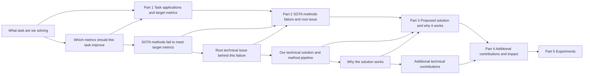

# Introduction Writing Guide

Two sources are fused here: Peng Sida's notes (how to plan the story, Parts A to C) and a sentence-level annotation of 55 award papers (what such introductions contain, routes by paper type, moves; `corpus-profile.md`). Labels such as `A:V1` and `C:V2` name the versions of Parts A to C; `routing.md` and the exemplar cards use them.

## Goal
Write a strong introduction in three steps:

1. Think through the introduction logic.
2. Apply a suitable template below.
3. Revise the introduction repeatedly, at the plan level (step 3 of the Paragraph Clarity Check in `SKILL.md`).

## What Award Introductions Contain (55 papers)
Each sentence of 55 award introductions was labelled with its function. Presence = number of papers in which the function occurs; position = where it first appears (0 = first sentence, 1 = last).

| Function | Papers | First appears at | Tier |
|---|---|---|---|
| Credit to prior work (specific achievements) | **55** | 0.03 | **always** |
| Gap (limitation, its reason, the tension) | 54 | 0.10 | **always** |
| Method | 54 | 0.41 | **always** |
| Results | 51 | 0.67 | **always** |
| Setting / task / concrete scene | 47 | 0.00 | usual |
| Insight or goal (usually just before the method) | 43 | 0.38 | usual |
| Contributions (list 16, prose 17, none 22) | 33 | 0.83 | common |
| Contrast with specific prior work | 32 | 0.58 | common — **write it for every method paper** |
| Stance | 28–35 | 0.88 | optional, at the end |

Shape:
- 6 prose paragraphs (p10–p90: 3–8), ~610 words (430–900), 26 sentences (17–38).
- The gap appears by paragraph 2 (median); the last paragraph is contributions (18), results (15) or a stance (7).
- One message per paragraph; the first sentence states it.
- No limitations paragraph (limitations go to report.md for the Limitations section).

## What Makes It Persuasive
1. **Tension before idea.** The gap is set up as a conflict the idea resolves. Award papers use: two goals that pull apart (*tradeoff*, 21/55), a missing capability (13), an obvious fix that is too expensive (8), an unexplained phenomenon (6), an open question (4), a belief the results overturn (2).
2. **Credit, then gap.** Every award introduction credits prior work with a specific achievement before criticising it, and describes the component it later blames.
3. **The insight as an observation.** 43/55 state an insight or goal, usually just before the method. Write the observation itself: “The highest frequency a scene can contain is bounded by the sampling rate of its views.”, “We find that …”, “The main idea is …”, “Our work is based on the observation that …”, “Surprisingly, …”. The skeleton sentences of Part C (`Our innovation is ...`) are fine for announcing it.
4. **A handle when there is one.** 27/55 name the idea itself (“next-brick prediction”, “foundation datasets”) — distinct from the method’s name. Name it once, where it is introduced, and reuse the same words.
5. **Position against the closest work.** After the method (median position 0.58), name the closest work and state one checkable difference — mechanism (most common), scope, cost, evaluation, assumption, input or output. Forms: “Unlike X, which …, our …”, “In contrast to X, which requires …, Y …”, “Previous work addresses … by …, which is not applicable to …”, “While X …, we …”. Reviewers will look for this paragraph.
6. **One concrete example.** 36/55 use a concrete example (an input that breaks prior work, a scene, a striking number, an analogy), usually in paragraph 1–2. A list of application domains is not an example.
7. **Promote the work.** Award introductions use evaluative words (*outperforms*, *efficient*, *first*, *effective*) about three times; back each with evidence. Do not be more modest than the evidence allows.
8. **Plain connective tissue, full sentences.** Award introductions use about one logical connector (however/therefore/thus/moreover/specifically/…) per 100 words (p10–p90: 0.4–1.4); sentences average 23 words. Let paragraph order and old→new information flow carry most of the logic, but keep relations inside sentences (*while*, *by*, *which*, *because*) rather than splitting every fact into its own short sentence or appending “, making …” clauses. Put short sentences at the pivots (the bottleneck, the cause, the idea) and keep the mean around 20–24 words. Colons are fine; dashes are not used (author preference; `style-rules.md` §1).
9. **Story, not tables.** A result sentence carries 0–2 numbers; the introduction carries a median of 4 numbers. Ablation values and protocol details stay in the experiments.
10. **Say each thing once.** Assign every claim (the gap, the insight, each advantage, each result) to exactly one paragraph. Do not restate the insight after the method and do not re-list the research questions. The contribution list is written by its own rules ("Contribution List"). Repetition was the most common weakness found by blind reviewers.
11. **Short background.** Award introductions reach the specific problem fast (the gap appears by paragraph 2). Keep generic field background to at most two sentences before the specific setting or credit.
12. **No implementation details** (layer counts, grid sizes, data pipelines, hyperparameters) unless they are the contribution.

## Introduction Logic Map


## How to Think About Introduction: Backward First, Then Forward
### Backward reasoning (answer these first)

1. What technical problem do we solve, and why is there no well-established solution? (important)
2. What are the contributions of our pipeline (e.g., a new valuable task, a new valuable metric, a new technical problem, or a new technique)?
3. What are the benefits of our contributions, why can they solve this technical challenge, and what new insight do they bring? (important)
4. How do we use prior methods to lead readers to our solved challenge and our new insight?

### Forward story (write in this order)

1. Introduce the paper's task.
2. Use prior methods to lead to the technical challenge we solve.
3. Present xx contributions to solve this technical challenge.
4. Explain technical advantages of our contributions and explicitly express our new insight. (important)

### From story to sentence plan

Before writing English, refine the forward story coarse to fine until you know what every sentence says:

1. Paragraph-level plan: one line per paragraph, written as a chain such as `what methods do -> what they achieve -> limitation -> technical reason`. One message per paragraph.
2. Sentence-level plan: under each paragraph, one line per sentence.
3. Keep refining the paragraph-level plan while writing its sentences; this is what makes a paragraph clear.

Plan the Introduction together with the comparison experiments and ablation studies the story needs (writing order in `SKILL.md`, step 2; `references/experiments.md` maps each claim to its experiment).

Worked example (ManhattanSDF, paragraph and sentence plans): `references/examples/introduction/writing-plan-manhattansdf.md`

## Section Skeleton
```latex
\section{Introduction}
% Task and application
% Technical challenge for previous methods (discuss around the technical challenge that we solved. A technical challenge includes both limitation and technical reason)
% Introduce our pipeline for solving the challenge
% Experiment
% Contributions
```

## Part A: Introduce Task and Application
### Version 1 (`A:V1`)

`Version 1: If the task is relatively niche, introduce the task first, then introduce applications.`

Writing structure:

1. Define the task in one clear sentence (`what output` from `what input`).
2. Briefly explain the task objective or scope (optional).
3. Introduce application value with 2-3 representative scenarios.

Sentence skeleton:

1. `[xxx task] targets at recovering/reconstructing/estimating [xxx output] from [xxx input].`
2. `[xxx task] has a variety of applications such as [xxx], [xxx], and [xxx].`

Local cite:

1. `references/examples/introduction/version-1-task-then-application.md`

### Version 2 (`A:V2`)

`Version 2: If the task is already familiar to most readers, introduce applications directly.`

Writing structure:

1. Skip formal task definition.
2. Open with application importance in one concise sentence.
3. Optionally append target requirement (e.g., accuracy/efficiency/robustness).

Sentence skeleton:

1. `[xxx task] has a variety of applications such as [xxx], [xxx], and [xxx].`

Local cite:

1. `references/examples/introduction/version-2-application-first.md`

### Version 3 (`A:V3`)

`Version 3: Introduce applications of the general task first, then introduce the specific task setting. (Personally recommended when the setting is relatively new.)`

Writing structure:

1. Start from the general task and why it matters.
2. Narrow down to the specific setting of this paper.
3. Clarify exact input/output and boundary of the setting.

Sentence skeleton:

1. `[general task] has a variety of applications such as [xxx], [xxx], and [xxx].`
2. `This paper focuses on the specific setting of recovering/reconstructing/estimating [xxx output] from [xxx input].`

Local cite:

1. `references/examples/introduction/version-3-general-to-specific-setting.md`

### Version 4 (`A:V4`)

`Version 4: If the task is familiar, introduce applications directly and expose the target technical challenge in the opening paragraph via previous methods (failure cases / target metric improvements).`

Writing structure:

1. Start with task/application importance.
2. Immediately summarize how representative previous methods work.
3. Immediately expose the unresolved failure case + technical reason.
4. Use this opening as a bridge to the later prior-work paragraphs.

Opening-paragraph skeleton:

1. `[Task/application importance sentence].`
2. `Given input ..., previous methods usually ...`
3. `Although they work in many cases, they fail at ... because ...`

Expert note:

1. It is often good if the first paragraph already states what problem you want to solve, instead of requiring several paragraphs of prior work before the challenge appears.
2. This style needs the right conditions and is less common.
3. Typical Version 4 flow: Part 1 (task + application and directly expose challenge via previous methods 1) -> Part 2 (previous methods 2 try to solve it but still fail) -> Part 3 (our method).
4. The other common flow: Part 1 (task + application) -> Part 2 (previous methods + limitation; the target challenge emerges here) -> Part 3 (our method).

Local cite:

1. `references/examples/introduction/version-4-open-with-challenge.md`

## Part B: Introduce Technical Challenge for Previous Methods (Very Important)
Purpose:

1. Discuss around the exact technical challenge we solved.
2. Build reader curiosity about how to solve this challenge.
3. Make motivation/benefit of our method clear.

Key logic before writing (faithful translation):

1. First make clear the logic for "leading to the technical challenge we solved".
2. For existing tasks: identify which recent methods have this challenge, why those methods exist, and optionally what earlier challenge they were trying to solve.
3. For novel tasks: at minimum, define the technical challenge solved by our pipeline.

Important warning :

1. Do not first present a naive solution and then describe our improvement over it.
2. That writing makes the work look like a low-score incremental patch.
3. Even if the work is actually incremental, do not write it this way.
4. Why: this writing style can erase reader curiosity and make the idea look straightforward only because the writing hand-holds the reader.
5. Ruling out an obvious alternative with a quantified reason is different and allowed (the `cost` route below).

### Technical-Challenge Version 1, `B:V1` (existing task, with existing methods)

`Version 1: For existing tasks, discuss the challenge chain from general challenge -> recent methods -> remaining challenge that we solve.` Keep the chain short: generic background takes at most two sentences and the gap appears by paragraph 2.

Writing structure:

1. Start with a general challenge statement for this task.
2. Briefly summarize recent methods (1) and their limitation with technical reason.
3. Briefly summarize recent methods (2) and their limitation with technical reason.
4. Ensure the final limitation is exactly the challenge your method solves.

Sentence skeleton:

1. `This problem is particularly challenging due to ...`
2. `Recently, ... methods ... However, they ... because ...`
3. `To overcome this challenge, ... methods ... However, they ... because ...`

Local cite:

1. `references/examples/introduction/technical-challenge-version-1-existing-task.md`

### Technical-Challenge Version 2, `B:V2` (existing task + our insight seen in traditional methods)

`Version 2: For existing tasks, when our insight has historical roots in traditional methods, use that line as conceptual backing and then show why new methods still fail.`

Writing structure:

1. Start from mainstream methods and state their limitation.
2. Introduce a classical/traditional line that already contains insight similar to yours.
3. Explain why that classical line is still insufficient.
4. Return to modern methods and show the unresolved technical reason.
5. Bridge to your method naturally.

Sentence skeleton:

1. `Traditional/recent methods ... However, they ... because ...`
2. `To overcome this problem, a typical approach is [insight], which has long been explored ...`
3. `However, these methods still ... because ...`
4. `To overcome this challenge, newer methods ... However, they ... because ...`

Local cite:

1. `references/examples/introduction/technical-challenge-version-2-existing-task-insight-backed-by-traditional.md`

### Technical-Challenge Version 3, `B:V3` (novel task, no direct methods)

`Version 3: For novel tasks without direct prior methods, define the challenge directly and decompose it into several concrete challenge points.`

Writing structure:

1. State the goal and explain that the problem is challenging for N reasons.
2. Use `First/Second/Finally` to separate independent challenge points.
3. For each point, state the observable limitation and the technical reason.
4. End with a transition to your pipeline.

Sentence skeleton:

1. `In this work, our goal is to ... This problem is challenging for three reasons.`
2. `First, ...`
3. `Second, ...`
4. `Finally, ...`

Local cite:

1. `references/examples/introduction/technical-challenge-version-3-novel-task.md`

## Part C: Introduce Our Pipeline for Solving the Challenge
Introduce two or three components through the problem each one solves and how they depend on one another (Pipeline Version 2 is the model). Avoid three same-shaped sentences in a row ("A does … . B does … . C does … .").

Key questions before writing:

### For existing tasks

1. What technical challenge does our pipeline solve?
2. What is our technical contribution?
3. Why can our method work in essence?
4. What benefits does our method have over previous methods?

### For novel tasks

1. What technical challenge does our pipeline solve?
2. What is our technical contribution?
3. Why can our method work in essence?

### Pipeline Version 1 (`C:V1`)

`Version 1: One contribution with multiple advantages, and one teaser figure to present the basic idea.`

Writing structure:

1. Introduce one core framework/representation for the target task.
2. Point to teaser figure for the basic idea.
3. State key novelty in one sentence.
4. Explain concrete implementation steps (`Specifically, ...`).
5. State multiple advantages (`In contrast ...`, `Another advantage ...`).

Sentence skeleton:

1. `In this paper, we propose a novel framework/representation, named ..., for ...`
2. `The basic idea is illustrated in Figure ...`
3. `Our innovation is in ...`
4. `Specifically, ...`
5. `In contrast to previous methods, ...`
6. `Another advantage of the proposed method is that ...`

Local cite:

1. `references/examples/introduction/pipeline-version-1-one-contribution-multi-advantages.md`

### Pipeline Version 2 (`C:V2`)

`Version 2: Two contributions, and one teaser figure to present the basic idea.`

Writing structure:

1. Introduce framework and key novelty sentence.
2. Point to teaser figure.
3. Explain contribution 1 and its advantage.
4. Introduce a remaining challenge, usually one that contribution 1 itself faces; otherwise the two contributions read as loosely connected.
5. Explain contribution 2 as the response to that challenge.

Sentence skeleton:

1. `In this paper, we propose ...`
2. `Our innovation is in ...`
3. `The basic idea is illustrated in Figure ...`
4. `Specifically, ...` (contribution 1)
5. `In contrast to previous methods, ...`
6. `However, ...` (remaining challenge)
7. `Specifically, ...` (contribution 2)

Local cite:

1. `references/examples/introduction/pipeline-version-2-two-contributions.md`

### Pipeline Version 3 (`C:V3`)

`Version 3: Build on a prior pipeline and introduce one new module, with a teaser figure for the basic idea.`

Writing structure:

1. Start from prior pipeline setup.
2. Introduce one new module as key innovation.
3. Provide an observation that motivates the module design.
4. Explain the module mechanism.
5. Compare against generic alternatives and state why it is better.

Sentence skeleton:

1. `Inspired by previous methods, ...`
2. `Our innovation is introducing ...`
3. `We observe that ...`
4. `Considering that ..., we introduce ...`
5. `In contrast to ..., our module ...`

Local cite:

1. `references/examples/introduction/pipeline-version-3-new-module-on-existing-pipeline.md`

### Pipeline Version 4 (`C:V4`)

`Version 4: Contribution comes from one important observation. Introduce key innovation first, then a listener-friendly observation as motivation, then method details, then benefits.`

Writing structure:

1. State key innovation first.
2. State one intuitive observation as motivation.
3. Explain implementation details.
4. Explain technical advantage and empirical gain.

Sentence skeleton:

1. `Our innovation is ...`
2. `We observe that ...`
3. `Considering that ..., we ...`
4. `This leads to ... and achieves ...`

Local cite:

1. `references/examples/introduction/pipeline-version-4-observation-driven.md`

### Not Recommended Writing

`Not recommended: If the method is simple, do not hide concrete method design in Introduction and only describe abstract insights to make the work look novel.`

Expert note:

1. In this template, the writing craft is about making a simple pipeline sound novel.
2. The key caution: people often make the pipeline steps sound novel, not the real insight.
3. In most cases this is not recommended. The better target is to clearly explain core contribution implementation in Introduction.

Why not recommended (writing structure warning):

1. Presenting only abstract insight without concrete pipeline steps weakens technical clarity.
2. Introducing many new terms without mechanism-level explanation creates a novelty illusion.
3. Reviewers may interpret this as shallow or incremental work.

Local cite:

1. `references/examples/introduction/pipeline-not-recommended-abstract-only.md`

## Route Paragraph Plans

One plan per route of `routing.md`.

### `failure` (card: mip-splatting)
1. Task → lineage ending at the method you fix; credit it with specifics.
2. How that method works — include the component you will blame.
3. Failure condition (Fig. 1) → root cause → mechanism (“Specifically, [condition] changes A while B stays fixed, causing …”).
4. Key insight → contribution 1 (answers symptom 1). “Nonetheless, [symptom 2] …” → contribution 2.
5. Contrast with how prior work handles it + benefit beyond training conditions; evidence with numbers; contributions.

### `cost` (card: mip-nerf)
1. Credit the method; state the flaw as a thesis (“is flawed in a manner that …”).
2. Mechanism; “works well when [contrived condition] … but in less contrived scenarios …”.
3. Obvious fix → why it is prohibitive, **quantified**.
4. Borrowed or new principle that moves the cost (e.g., pre-filtering); our method.
5. Evidence (numbers) + secondary advantages (speed, size).

### `capability-gap` (card: dreambooth)
1. Concrete scenario(s) a reader can picture; why it is hard.
2. Credit current models; “they lack the ability to …”; “The main reason is …”.
3. Goal phrased as a mechanism; technique 1.
4. Side effect of technique 1 → technique 2.
5. Applications; new evaluation (dataset/protocol/user study) for the new task.

### `insight` (card: dpo)
1. Why the capability matters, with one or two vivid examples.
2. Dominant method credited; its cost itemised.
3. “In this paper, we show that [objective] can be optimized [directly] …” + the analytical observation.
4. Intuition of the resulting update/design; mechanism-level contrast (“While existing methods use X to …, we use it to …”).
5. Single main contribution; evidence with scope (tasks, model size).

### `trend` (no exemplar card yet)
1. Problem + approach category in sentence 1; 3-stage history; “Even so, [old paradigm] still …”.
2. “As [enabler] improves, we ask whether … almost entirely”; closest work with two checkable limits.
3. “We take a further step towards …”; method answering each limit; calibrated result; named departure.
4. Optional side claims, each with its exception or pre-empted objection.

### `scaling` (L3, empirical scaling / recipe)
1. The ingredient that drove progress elsewhere, or the practical decision at stake (with a concrete number).
2. The state of this field: what people use and believe, and what prior attempts found.
3. The open question, asked plainly.
4. What we changed to make the study possible (the ingredients/setting), in a short enumerated sentence.
5. The regularity found, with the headline numbers and the most surprising observation; contributions.

### `mechanism` (L5, analysis / explanation)
1. The phenomenon, stated so a newcomer sees why it is puzzling.
2. Existing explanations and why they do not account for it (one sentence each).
3. Our claim, named (“implicit X”, “two timescales”), stated as the paper’s thesis.
4. The mechanism in one or two sentences, with intuition.
5. Evidence from two sides (controlled experiments + tractable model), with key numbers; contributions.

### `resource` (L7, dataset / benchmark / platform)
Coarse arc in award papers: Gap → Resource → (Gap) → Method/collection → Result.
1. The capability the field wants and why existing data cannot deliver it (scale, realism, diversity, labels, representativeness) — a concrete number or example.
2. Why the obvious way to collect it fails (cost, hardware, privacy); our collection principle.
3. What the resource contains, with one or two scale numbers; the closest existing datasets and the checkable difference.
4. What it enables: baselines, a benchmark, a model trained on it, or findings — stated as findings, not as possibilities.
5. Release and contributions.

### `measurement` (L8, sensing / optics / physical system)
Coarse arc: Setting (what we want to measure) → Gap/tradeoff of existing sensors → Method (sensing principle) → Result (prototype).
1. The phenomenon and why measuring it matters, with a concrete scene.
2. Existing sensors and the tradeoff they face (speed vs. resolution, bandwidth vs. range…).
3. The principle we borrow or introduce and how it escapes the tradeoff.
4. Prototype and demonstrations; contributions.

### `theory` (L6)
Coarse arc: Setting/question → prior results → main result in words → comparison with known bounds → implications.
1. The question and why it is open or important.
2. What is known (prior bounds, assumptions) and what is missing.
3. Our main result in plain words (cite the theorem), then the technique.
4. How it compares with known results; implications; outline (theory papers often end with an outline).

### `re-examination` (L4)
Coarse arc: Credit/common belief → question → our test → findings → stance.
1. The belief or practice and its supporting evidence, credited fairly.
2. The question we ask and why the existing evidence does not settle it.
3. Our test (controlled comparison, new metric) in one paragraph.
4. Findings, then a stance that follows from them (“X is a property of the metric, not of the model”).

## Sentence-Level Moves and Exemplars

Retrieve examples of a move from `exemplars/moves.jsonl`.

| Move id | Purpose |
|---|---|
| `intro.task` | define task / importance concretely |
| `intro.gap.assumption` | prior methods assume X; X breaks when … |
| `intro.gap.failure` | credit + observable failure under a condition |
| `intro.gap.mechanism` | why the failure happens (what changes, what stays fixed) |
| `intro.gap.reason` | “The main reason is …” |
| `intro.gap.cost` | the method/fix is too expensive, quantified |
| `intro.gap.capability` | models lack the ability to … |
| `intro.gap.unknown` | origin/why remains unclear |
| `intro.question` | “This raises the question …” / “we ask whether …” |
| `intro.insight` | the observation the method follows from (state it directly) |
| `intro.borrowed-principle` | principle from another field that solves the cost |
| `intro.goal` | goal phrased as a mechanism |
| `intro.remaining-problem` / `intro.second-technique` | problem left by contribution 1 → contribution 2 |
| `intro.contrast-mechanism` | “While existing methods use X to …, we …” |
| `intro.claim-exception` | strong claim with its exception in parentheses |
| `intro.stance` | what the work changes for the field (see `claim-calibration.md` §5; exemplars: `abstract.open.position`) |
| `intro.evidence` | calibrated result sentence with scope |
| `intro.ours` | “In this work, we present …” |
| `intro.scope` | “Our focus is on A, rather than on B.” |
| `intro.contribution` | contribution sentence(s) |
| `relwork.contrast` / `relwork.complementary` / `relwork.closest` | positioning |
| `abstract.open.*` | abstract first sentences by opening type |
| `pattern.*` | reusable sentence patterns |

`python3 scripts/find_exemplars.py --para <function> [--type L7]` prints award-paper paragraphs whose main function is `scene`, `task`, `credit`, `history`, `gap`, `reason`, `tension`, `question`, `goal`, `insight`, `method`, `mechanism`, `contrast`, `result`, `theory-result`, `stance`, `scope`, `contribution`, `outline`, with a note on why each works. `--phrases <function>` prints sentence frames with examples. Study the order of information, never copy wording.

## Contribution List
The authors write the list. Use these rules to check it, or when an author asks for an edit to it (user 2026-11-15).

1. Method and finding items name no specific benchmark. They say what the method does and what was found in
   general terms (`on a public benchmark`, `on unseen tasks`, `without the extra module`).
2. Benchmark names and numbers go in the results item, the last one. A comparison that carries a number is
   stated there once: `... on <Benchmark> (<ours>\% against <baseline>\%)`.
3. The results item is titled with the improvement, not `Experimental results`:
   `Significant improvements on six benchmarks`, where the count matches the benchmarks the item lists.
4. A result appears in one item only. Before adding it to one item, check the others for the same comparison.

Check: `grep -n '\\item' <intro file>` and read each item but the last for benchmark names.

5. The Introduction always ends with the list ("Section Skeleton"). Items may run to several sentences; modules of one method go in one item, and analysis findings or resources get their own.
6. The list states the same claims, at the same strength, as the abstract.

## Example Bank
1. `references/examples/introduction-examples.md`
2. `references/examples/introduction/version-1-task-then-application.md`
3. `references/examples/introduction/version-2-application-first.md`
4. `references/examples/introduction/version-3-general-to-specific-setting.md`
5. `references/examples/introduction/version-4-open-with-challenge.md`
6. `references/examples/introduction/technical-challenge-version-1-existing-task.md`
7. `references/examples/introduction/technical-challenge-version-2-existing-task-insight-backed-by-traditional.md`
8. `references/examples/introduction/technical-challenge-version-3-novel-task.md`
9. `references/examples/introduction/pipeline-version-1-one-contribution-multi-advantages.md`
10. `references/examples/introduction/pipeline-version-2-two-contributions.md`
11. `references/examples/introduction/pipeline-version-3-new-module-on-existing-pipeline.md`
12. `references/examples/introduction/pipeline-version-4-observation-driven.md`
13. `references/examples/introduction/pipeline-not-recommended-abstract-only.md`
14. `references/examples/introduction/writing-plan-manhattansdf.md`

## Checklist
- [ ] Does the first sentence of each paragraph state its message?
- [ ] Does each paragraph carry one message only?
- [ ] Are technical challenge, technical reason, and solved mechanism all explicit?
- [ ] Are claims in Introduction aligned with experiment evidence?
- [ ] Is terminology stable across all sections?
- [ ] Do the contribution items before the results item name no benchmark, and does the results item's title state the improvement?
- [ ] Credit to specific prior work precedes the gap; the component blamed later is described first.
- [ ] Gap = what fails/is missing + technical reason + condition, set up as a tension.
- [ ] A contrast paragraph or sentence names the closest work and one checkable difference.
- [ ] The insight is stated as an observation.
- [ ] The handle appears where the idea is introduced; the core idea is asserted, not hypothesised.
- [ ] One concrete example in paragraph 1 or 2.
- [ ] No limitations, failure cases or disclaimers; mixed results scoped to the wins.
- [ ] Every gap ↔ one contribution.
- [ ] Results as claims with headline numbers; wording is the strongest the claim map allows; the work is promoted with evidence.
- [ ] A stance sentence if the results support one; no implementation details; no defensive qualifiers.
- [ ] Each claim appears in one paragraph only; generic background ≤ 2 sentences.
- [ ] The cause has its own sentence (“The main reason is that …”); the tension and the idea are stated in short, quotable sentences.
- [ ] Sentences average 20–24 words with short pivots; no run of three short sentences; no sentence over ~35 words; a claim and its number share a sentence.
- [ ] No dashes; few trailing participial clauses.
- [ ] `check_draft.py` shows no ERROR and no WARN for connectors, numbers, sentence length or participial clauses (or each is justified).
