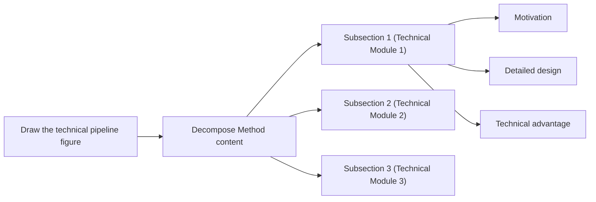
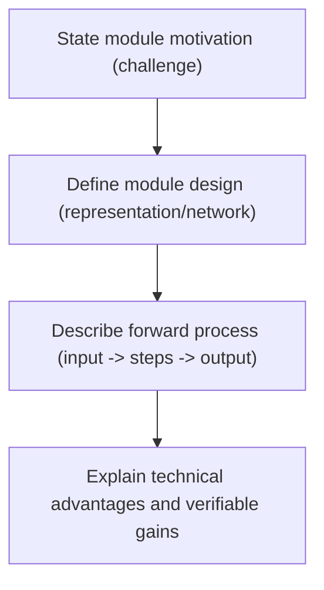

# Method Writing Guide

Fused from Peng Sida's notes (the three elements of a module, how to write and check them) and the method sections of 55 award papers (the section structure of 55 award papers (42 with a cleanly parsed method and experiments section) and a close reading of the method sections of 14 of them (DreamBooth, pixelSplat, Mip-Splatting, VGGT, Mip-NeRF, Swin, OmniMotion, DPO, IPG, NWM, DynIBaR, Imagen, MegaSaM, EPro-PnP). Quotes are verbatim and shown for structure only).

## Goal
Write the Method section clearly by following this sequence:

1. Answer key method-design questions.
2. Draw a pipeline figure sketch.
3. Write the method section step by step.

## Shape (what the corpus shows)
| Observation | Value |
|---|---|
| Length | median ~1,700 words, about as long as the experiments (~1,500) |
| Preliminaries / background section before the method | 12 / 42 papers (when the method modifies a known model: 3DGS, NeRF, RLHF, diffusion) |
| Method section title | named after the method or idea in 23 / 42 (“Mip Gaussian Splatting”, “Image-conditioned 3D Gaussian Inference”); generic “Method/Approach” in 12 / 42 |
| Number of method sections | usually one, with 2–4 subsections; some split representation and optimization (OmniMotion) or formulation and algorithm |
| Implementation details | in the experiments setup (13 / 42) or the appendix; almost never inside the method (2 / 42) |
| Analysis section between method and experiments | when the method has a theoretical reading (DPO “Theoretical Analysis”, Mip-Splatting “Sensitivity to Sampling Rate” before the method) |

## Pre-Writing Questions
`Before writing Method, first answer: (1) what modules exist in the method, and (2) for each module, what is the workflow, why this module is needed, and why this module works.`

Recommended organization:

1. List all modules in the pipeline.
2. For each module, answer three questions:

- How does the module run?
- Why do we need this module?
- Why does this module work?

3. Organize answers as a mind map or a table for clarity.

## Method Writing Steps
`Method writing steps: (1) draw pipeline figure sketch, (2) map subsections from the sketch, (3) plan each subsection with motivation/design/advantages, (4) write module design first, (5) then add motivation and technical advantages.`

Step-by-step workflow:

1. Draw the pipeline figure sketch.
2. Use the sketch to organize Method subsection structure.
3. For each subsection, plan three parts: motivation, module design, and technical advantages.
4. Write module design first to build a concrete backbone.
5. Add motivation and technical advantages afterward.

## Three Elements of a Pipeline Module
`A pipeline module has three elements: Module design, Motivation of this module, and Technical advantages of this module.`

### 1) Module Design

Definition:

1. Describe representation/network/data-structure details.
2. Describe the forward process clearly: given input -> step 1 -> step 2 -> step 3 -> output.

### 2) Motivation of This Module

Definition:

1. Explain why this module is needed.
2. Use problem-driven logic: because problem X exists, we design module Y.

### 3) Technical Advantages of This Module

Definition:

1. Explain why this module has technical advantage over alternatives.
2. Tie advantage to measurable behavior when possible.

### Example of the Three Elements

Local cite:

1. `references/examples/method/example-of-the-three-elements.md`

## Method Content Decomposition


## The Five Moves

Every method is different, but award method sections do the same five things.

**M1 · Opener: task, input, output, parts.** One paragraph that restates the goal in operational terms and names the two or three components, pointing to the overview figure.
> “Given a pair of images and their associated camera parameters, our method infers a 3D Gaussian representation of the underlying scene, which can be rendered to produce images of unseen viewpoints. Our method consists of a two-view image encoder and a pixel-aligned Gaussian prediction module.” (pixelSplat)

**M2 · Preliminaries and notation (only what the method changes).** Review the model you modify, define every symbol once, and stop. Announce why it is needed.
> “In this section, we first review the sampling theorem in Section 3.1, laying the foundation for understanding the aliasing problem.” (Mip-Splatting)
> “The input is a sequence (I_i) of N RGB images …, observing the same 3D scene.” (VGGT)

**M3 · One subsection per component: need → mechanism → property.** Open each subsection with the problem it solves (often pointing back to the introduction), then the mechanism with its equation, then why it works or what property it guarantees. A component that fixes a side effect of the previous one is introduced through that side effect.
> “As discussed in Sec. 1, classical motion representations, such as pairwise optical flow, lose track of objects when they are occluded … To obtain accurate, consistent tracks even through occlusion, we therefore need a global motion representation …” (OmniMotion)
> “Our first task is to implant the subject instance into the output domain of the model … One natural idea is to fine-tune the model using the few-shot dataset of the subject.” then “… which gives rise to the problem of language drift.” (DreamBooth, the second component answers the first one’s side effect)
> “To overcome these challenges, we make two modifications to the original 3DGS model.” (Mip-Splatting)

**M4 · Objective and optimization.** The loss (with each term motivated), what is optimized and what is fixed, inference procedure. Keep hyperparameter values for the experiments or appendix.
> “Our optimization process takes as input a video sequence and a collection of noisy correspondence predictions … as guidance, and generates a complete, globally consistent motion estimate for the entire video.” (OmniMotion)

**M5 · Contrast and interpretation (where it adds insight).** A sentence or short subsection that relates the design to prior mechanisms or explains it theoretically, at the level of mechanism, not of results.
> “Unlike prior RLHF methods, which learn a reward and then optimize it via RL, our approach bypasses the reward modeling step …” (DPO)
> “Aside from cone-tracing and IPE features, mip-NeRF behaves similarly to NeRF …” (Mip-NeRF, stating what does not change)

## Method Section Skeleton
```text
\section{<Method name or idea>}            % M1: goal, input → output, components, Fig. 2
\subsection{Preliminaries}                 % M2: base model + notation (if modifying one)
\subsection{<Component 1>}                 % M3: need → mechanism (Eq.) → property
\subsection{<Component 2>}                 % M3: often answers a side effect of component 1
\subsection{Training and inference}        % M4: objective, optimization, inference
\subsection{Discussion} (optional)         % M5: relation to prior mechanisms / theory
```

Local cite:

1. `references/examples/method/section-skeleton.md`

## Overview Subsection (M1)
`Overview should usually include: setting, core contribution, optional pipeline figure pointer, and a map of what each subsection contains.`

Writing structure:

1. One to two sentences for task setting.
2. One to two sentences for core contribution.
3. If pipeline/framework is novel, point to overview figure.
4. Tell readers what Section 3.1/3.2/3.3 covers.

Local cite:

1. `references/examples/method/overview-template.md`

## Module Subsections (M3)
`Basic subsection logic: (1) motivation of this module, (2) module forward process/module design, (3) technical advantages of this module.`

Local cite:

1. `references/examples/method/example-of-the-three-elements.md`



## How to Write Module Design
`Module design usually has two parts: (1) describe specific data/network structures, and (2) describe forward process as input -> steps -> output.`

Writing structure:

1. Define key structures first (representation, network, data structure).
2. Write forward process in strict execution order.
3. End with output interpretation or purpose.

Sentence skeleton:

1. `We represent ... with ...`
2. `Given [input], we first ... then ... finally ...`
3. `This produces [output], which is used for ...`

Local cite:

1. `references/examples/method/module-design-instant-ngp.md`

## How to Write Module Motivation
`Module motivation is usually problem-driven: because a problem exists, we design xx to solve it.`

Typical opening sentences:

1. `A remaining problem/challenge is ...`
2. `However, we ...`
3. `Previous methods have difficulty in ...`

Local cite:

1. `references/examples/method/module-motivation-patterns.md`

## Rules
1. **Every method subsection answers a claim from the introduction**, and every claim made in the introduction is realised by a subsection (extend the claim map: claim → method subsection → experiment → ablation).
2. **Need before mechanism.** The first sentence of a subsection says what problem it solves; the equation comes after.
3. **Define each symbol once**, at first use, and keep notation fixed; prefer one notation table in the preliminaries for heavy notation.
4. **Equations carry the mechanism, prose carries the reason.** After each key equation, one sentence on what it means or why it works (“Intuitively, …”, “This term encourages …”). A standard component (a loss, schedule or estimator the field has a name for) is written by its name, not re-derived as an equation; the equation is for what the paper defines or changes (`../SKILL.md` Rules, "A known name instead of its formula").
5. **Say what stays the same** as the base method; reviewers need to see the delta.
6. **Rule out the obvious alternative** with a reason when one exists (“One natural idea is … However …”).
7. **Implementation details** (layer counts, learning rates, iterations, hardware) go to the experiments setup or the appendix, unless they are the contribution.
8. **No results in the method**, apart from a pointer (“we verify this in Sec. 5.3”).
9. **Mechanisms the author has not given are `[TODO]`**, never filled with plausible-sounding inventions. Ask for equations, losses and algorithm steps.
10. Style: present tense, “we” for decisions, the method name as subject for what it does. No dashes (author preference); colons are fine before an enumeration or equation.
11. **Author rulings win over this list** (`../../shared-references/manuscript-craft.md` §2, Method, user 2026-11-16). They close three gaps a reviewer attacks between the Method and the experiments; "Configuration, Filters and Training Unit" below shows how to write each.

## Configuration, Filters and Training Unit

Three things the Method must say before the reader meets the results tables.

**1. Which configuration the main rows run.** List every component that has more than one possible source (a ground-truth label or a model's prediction, a privileged input or a deployable one). For each, find the source the method's reported rows use in the results table, and write that one into the pipeline. The other source is a variant, named as its table row is named, with a pointer:
- `<Method> takes <signal> from <source A>; <source B> can supply it instead, as in the variant <row name> (Sec. <k>).`

Check the Abstract and Introduction: a capability claimed there ("needs no X") must match a variant here, not the default. Do not move the variant's result into the Method (Rule 8); the pointer is enough.

**2. Why each filter.** For every condition under a set-builder, sum or union in an equation (a success label, an excluded event, a threshold), write one sentence of reason next to the equation. Allowed reasons, in order of preference:
- by construction: what triggers the excluded event, or what the kept data are then guaranteed to contain. Read the code or prompt that defines the trigger before writing it, and describe the trigger where the component is introduced if the Method has not;
- cited work;
- the paper's own ablation, only where its difference is significant.

A mechanism that sounds right but nothing tested is `[TODO]` (Rule 9). An ablation cell that did not reach significance is not a reason; leave it in its table.
- `We drop every <sample> in which <event>: <component> causes <event> only when <condition>, so such a <sample> contains <what the filter removes>.`

**3. One model or one per domain.** When the results tables span domains (simulators, embodiments, datasets), say in the subsection that defines training whether one set of weights serves all of them or each domain gets its own run, and for a per-domain run, from which starting weights, on which data and with which data replacing the default ones. Write only what holds for every domain; per-domain specifics and counts go to the appendix with a pointer. This sentence does not belong in an Advantages paragraph or first in the experiments' Setup.
- `We run the same <loop> once in each of <domains>, starting from the weights we evaluate there, and in each <Method> runs the weights trained there.`

## Implementation Details
`Implementation details include hyperparameters (e.g., layer count, feature dimensions), coordinate transforms/normalization, and other practical details. Put them in the experiments setup or the appendix, not in Method, unless they are the contribution.`

## How to Check Whether Method is Easy to Understand
`Check method clarity from three levels: writing logic, paragraph writing, and sentence writing.`

### 1) Logic-level check

1. After finishing the paper, summarize the Method writing logic again.
2. Check whether this summarized logic is smooth and easy to follow.

### 2) Paragraph-level check

1. The first sentence of each paragraph should make readers immediately understand what this paragraph is about.
2. One paragraph should clearly deliver one message.

### 3) Sentence-level check

1. Carefully check whether the **motivation** of each sentence is explicit. Keep one thing clear to readers at all times: **why this sentence content is needed**.
2. Carefully check sentence-to-sentence flow.
3. Carefully check term consistency and avoid changing key terms back and forth.

## Example Bank
1. `references/examples/method-examples.md`
2. `references/examples/method/pre-writing-questions.md`
3. `references/examples/method/module-triad-neural-body.md`
4. `references/examples/method/module-design-instant-ngp.md`
5. `references/examples/method/module-motivation-patterns.md`
6. `references/examples/method/section-skeleton.md`
7. `references/examples/method/overview-template.md`
8. `references/examples/method/example-of-the-three-elements.md`
9. `references/examples/method/method-writing-common-issues-note.md`

## Checklist
- [ ] The opener states input, output and the components, and points to the overview figure (drawn as in `figures.md`, "Method Overview Figure").
- [ ] Each subsection opens with the problem it solves; each key equation is followed by its meaning.
- [ ] No equation restates something the field has a standard name for; each equation is a quantity the paper defines or changes.
- [ ] Every symbol is defined once; notation matches the figures.
- [ ] The delta to the base method is explicit; the obvious alternative is ruled out where relevant.
- [ ] Every introduction claim maps to a subsection and to an experiment.
- [ ] No hyperparameters or results; no invented mechanisms (`[TODO]` instead); no dashes.
- [ ] The pipeline is the configuration the main rows run; each alternative source is a named variant with a pointer.
- [ ] Every filter in an equation has its reason beside it: by construction (checked against the code), cited, or a significant ablation.
- [ ] Before the first results table, the reader knows whether one model serves every benchmark or each domain has its own.
